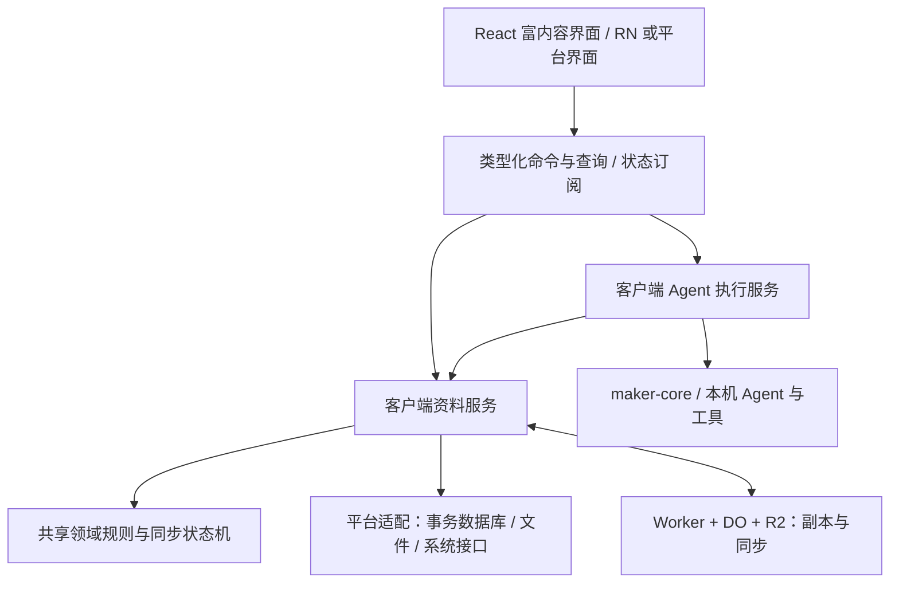

# Umeda 客户端架构：富交互界面与独立数据服务

> 状态：Umeda 个人分支的目标架构约定，2026-11-21。现有实现并未全部符合。
> 产品正本见[产品方向](../product-rules/umeda-product-direction.md)，缺口与验收见
> [优化路线图](../umeda-optimization-roadmap.md)。本文不修改现行 wire protocol。

## KOS 底层融合的后续约束（2026-11-23，待设计与实现）

最新产品范围以[产品方向](../product-rules/umeda-product-direction.md#kos-作为全系统底层的后续方向2026-11-23)
为准：KOS 是整个 Umeda 共用的长期工作与知识信息体系。下文较早把 KOS 仅列为知识资源的
表述描述当时分工，不限制本轮确认的范围；现有代码落点与已实现能力仍按各节日期读取。

下一阶段先核对旧 kos-framework，再将 KOS 逻辑优化与项目闭环融合一起设计。需要明确
目标／项目／行动、资料、执行任务、检查点与工作记录的身份、关联、来源和唯一写入入口，
让人和不同 Agent 通过同一套服务使用相关信息。具体对象字段、目录与生命周期尚未定稿，
不能把旧目录原样迁入或把当前简化字段当作最终模型。

复用现有工作管理、资料服务、Session 和引擎切换；统一语义与关联不要求合并物理数据库，
也不新增执行状态机。桌面插件与手机 WebView 可继续作为视图；系统级信息服务的能力不应
依赖打开这些视图。各类事实保持唯一负责人，不同步复制执行端代码、凭证或全量聊天上下文。
共用底层仍遵守主人提示后按需加载，切换引擎不自动读取全部业务或知识背景。

本轮只保存开发方向。旧库写入切换、存储／协议、权限和系统提示词的具体改动在实施前
按已有专项规则核对；源框架核对清单、顺序与分层验收见
[路线图](../umeda-optimization-roadmap.md#kos-底层融合与逻辑优化2026-11-23待实施)。

## Umeda 内部的组合关系（2026-11-22，KOS 范围按上节更新）

Umeda 是应用与总入口，下面各项均是组合进 Umeda 的对象或能力，而非与它并列的系统。
产品归属与底层服务调用分开理解：

```text
Umeda 应用
├── 工作组织：空间、目标、项目、行动事项、工作记录
├── 伙伴：长期 Agent 身份、资料与能力配置
├── Agent 接入：Claude Code、Codex、Pi 等执行引擎
├── 资源：KOS 知识库、代码仓库及其他文件／应用
└── 客户端基础设施：设备、运行、工具、存储、索引、展示、同步与恢复
```

Agent 通过 Umeda 提供的工具读取和写入 KOS；理解、研究、整理和生成发生在实际接入的
Agent 中。KOS 是带必要内容结构和来源关系的知识资源，不包含独立的 Agent 或知识流程
运行时。Umeda 的资料服务负责字节／版本／索引等存取事实，不为 KOS 另造智能后端。

旧「KOS Agent + DSH + Obsidian」不作为新架构的产品边界。DSH 未来可以作为 Umeda 的
可选 Agent 接入，但 KOS 不依赖这个接入存在。Agent 的工作方法可以使用可选 Skill 和
知识中的约定，不能据此恢复一套 KOS 专有调度、执行循环或唯一智能入口。

## 当前架构与目标的区别

| 层 | 当前事实 | 目标职责 |
| --- | --- | --- |
| 桌面宿主 | Electron；Main 独立同步托管目录；KOS 常驻插件运行共享资料服务，使用已有 Library SQLite | 提供应用级资料服务、执行服务与平台适配，富界面继续可嵌入 |
| 手机宿主 | Expo / React Native；应用持有共享资料服务与 SQLite；KOS WebView 调领域命令 | 持有本地资料服务和同步任务；RN 或原生界面消费统一服务 |
| 富交互界面 | `kos-workbench` 的 React DOM；`LibraryClient` 消费宿主投影，`store.ts` 只保留兼容导出 | 看板、编辑、阅读与社区组件；只持有临时交互态和服务投影 |
| 本地数据 | Mac 托管目录、同步状态／历史；0.4.0 两端使用结构化目录／outbox／移动队列、不可变内容文件和本机搜索投影，偏好及编辑中草稿保留 KV | 稳定身份的托管资料库；事务元数据、文件内容、可重建索引和持久 outbox |
| 云端 | Worker / DO 的版本元数据、R2 文件、持久指令收件箱 | 同步协调、云端副本、投递与回执；不充当当前 Mac Agent 运行时 |
| Agent | Desktop 宿主接 maker-core 与实际引擎／工具 | 通过服务读写资料，运行状态独立于 UI；后续单独优化质量 |

上表“当前”指 2026-11-21 的 0.4.0 源码，不代表旧安装已经升级。2026-11-22 新增的 Agent
知识库入口与范围见下节。schema 2 引入不可变内容文件
和结构化目录／操作表，schema 3 追加移动队列、内容字节登记和书籍定位；旧记录保留。
离线移动由宿主保存、投影与条件重放，模糊回执先保护保存入口，再核对目标身份与来源别名；
冲突不覆盖目标。PDF／EPUB 的文字提取属于可取消的富内容派生任务，宿主保存文本、定位与
完成态，检索只覆盖当前哈希且已完成的索引；该提取任务不承诺离页或 iOS 后台继续。
附件仍跨桥分块，完整附件服务、索引重建产品入口与内容回收仍未完成。
外部工具改名识别、路径复用后的结构化引用、首次安装完全离线的无归属记录，以及迁移回退
的完整界面仍需后续收敛，不能用稳定 ID 的基础接口宣称全部场景已解决。

Xcode 编译手机原生宿主及依赖，同时打包 JS；存在 Swift 入口不表示 UI 和业务全用 Swift。
React Native 能通过原生模块接系统 API；Web React 社区组件仍需要 DOM 内容面。
平台能力的多少取决于宿主接口与实现，而非界面是否使用 React。

### Agent 知识资源入口（2026-11-22，源码）

`cindy_helper` 新增可发现的 `knowledge` 类，Codex／Claude Code／Pi 共用列库、列目录、
字面搜索、分段读取和条件保存入口。Desktop 适配位于 `main/vault-sync/knowledge.ts`，
只读取当前中转对应的已托管目录，不扫描 Agent workdir，也不触发旧库迁移或建立第二份副本。
普通 Cindy 未启用个人独立中转时不注册这组工具；调用仍经过既有任务能力面和权限入口。

这是一条现有本机镜像的资源适配，不是另一个 `LibraryService`，也不是新的 KOS Agent。
不依赖资料页面打开，离线可读写；保存复用 `VaultFolder.replace` 的哈希条件替换和原有
副本历史目录，后续由既有文件监听与同步循环发布。仅返回 `local_saved`、`sync_status:
not_confirmed`，不把本机成功解释为云端提交或手机收到。失去回执先读取核对内容哈希；
并发变化返回冲突，不自动用旧正文重写。

搜索当前只覆盖本机镜像内的 Markdown／纯文本，不消费页面 SQLite 的 PDF／EPUB 派生索引，
不覆盖手机尚未上传的编辑。目录枚举不读取或哈希附件；搜索与正文按需读取，返回值有分页／
字节预算、来源三元组 `vault_id/path/hash` 与覆盖缺口。分段续读携带已读哈希，避免拼接不同
版本。此来源是路径与内容证据，不宣称为改名后仍可解析的稳定文档链接。

后续收敛方向仍是统一应用级资料服务、可重建检索索引与稳定引用；不要把本批适配扩展成另一套
持久索引、编辑 outbox 或智能工作流。Mac／iPhone 新安装及真实模型调用暂缓，不能用合成副本
传播测试宣称已通过实机验收。

## 分层与依赖

下图是 Umeda 内部的服务调用关系，不表示存在与 Umeda 平级的工作系统或 KOS 智能系统。



共享规则不 import Electron、Expo、React 或页面生命周期。宿主注入存储、网络、时钟与调度
适配；Main 继续使用静态 import。资料与 Agent 服务通过明确接口协作，不能相互 import
界面组件。具体包名在实现时按依赖图决定，本文不预建空包或另一套 Agent 编排。

“客户端承担”包含 TypeScript 宿主服务、平台数据库与原生模块，不要求全部改成 Swift。
纯领域规则优先共享；有平台差异的 I/O 与交互按平台实现，不为共享率牺牲体验。

宿主落点：桌面由 Main 管理服务生命周期，耗时索引／解析通过受管 worker 等机制隔离，
不阻塞 Electron 主事件循环；iOS 由 RN 宿主组合共享规则与平台数据库／文件适配，必要的
系统生命周期或原生能力再落到原生模块。不能把业务挪进另一个 React Provider 就称为
脱离界面，也不能把所有计算塞进 Swift 的 UI 主线程。是否单独守护进程按运行需求决定。

## 能力归属

| 能力 | 事实与持久化的负责人 | UI / 社区组件的工作 |
| --- | --- | --- |
| 自动建库、导入、迁移、导出 | 客户端资料服务 + 文件／系统适配 | 展示选择、进度、结果与恢复入口 |
| 文档、属性、附件、链接与阅读记录 | 资料服务的命令、版本和内容存储 | 编辑、选择、渲染、临时撤销与选区 |
| 搜索、索引、离线资料 | 客户端索引及离线策略；云端可补充未下载内容 | 输入查询、分页展示、标明覆盖范围 |
| 草稿与待同步修改 | 独立于页面的事务存储、outbox 与恢复状态机 | 尽快提交编辑意图，显示保存状态 |
| 跨端同步与冲突 | 共享规则 + 各端资料服务；云端协调版本 | 显示范围，提供比较、保留与恢复动作 |
| 分享、文件选取、生命周期、小组件 | 平台宿主；按需原生模块 | 使用宿主提供的有界命令与数据投影 |
| Agent 调度、工具执行、上下文装配 | 现有执行服务／maker-core；知识引用由资料服务提供 | 表达意图，展示过程、来源与结果 |

界面可维护编辑中的内容，但不能是唯一持有已承诺保存内容的进程。关闭／崩溃 WebView
不应丢失已落盘操作，也不应终止宿主仍有执行条件的同步。
iOS 服务脱离 WebView 并不赋予无限后台时间；进程被系统挂起后保留持久队列，下次获准
运行时恢复。桌面同步、手机资料同步与指令 outbox 各有事实边界，不强行合成一个队列。

## 本地优先的数据模型

目标采用**应用托管的内容文件 + 事务数据库 + 可重建索引**：Markdown／原始附件仍可导出，
SQLite 类事务存储记录身份、路径映射、版本、草稿、outbox、同步游标和恢复日志。
索引是派生数据，不能成为唯一正文或未同步编辑的存放处；不要直接跨端同步 SQLite 文件。
具体 schema、事务与内容文件之间的崩溃恢复顺序在实现前按数据库与存储规则设计。

- `libraryId`、`documentId`、`attachmentId` 是持久身份；路径、文件名、域名是可变属性。
  内容哈希用于校验／复用，不作为可编辑文档的身份。现行路径协议需要兼容映射，不能直接替换。
- 重命名／移动保留文档身份、阅读记录、引用和待同步操作；外部工具移动无法可靠识别时，
  明确处理歧义，不只凭相同内容猜测两个文件必定是同一文档。
- 附件字节放文件／blob 层，数据库保存引用和下载状态。Base64 JSON 不是长期的大附件存储方案。
- outbox 保存操作 ID、目标身份、基础版本、内容引用和状态；本机成功回执以持久提交为准。
  云端确认、游标推进和清队要能在重启后确定恢复，不许先清唯一副本。
- UI 局部偏好可留轻量 KV；文档、队列与索引不再依赖页面自行组织大段 JSON。
- 全文索引可采用 SQLite FTS 等实现，但须单独验证中文分词／子串、多语言和相关性；
  尚未下载的正文与附件、未提取的 PDF／EPUB 文本不能假装已被全文搜索覆盖。

默认新库的目录由宿主选择并自动维护；确切目录遵循[本地存储规则](credentials-and-local-storage.md)。
多端的“默认资料库”必须指向同一稳定身份：已有库优先发现并接入，不能每台设备自动建一个
互不相关的同名库。首次离线记录先保存在本机持久草稿，后续绑定明确的库，不通过库名猜测合并。
迁入旧库时先生成清单、复制到暂存区域、核对路径／数量／哈希／链接，再提交绑定并允许回退。
进度日志可重入，磁盘不足或中断时保持原库；旧缓存、草稿、队列必须单独迁移并验证，不能当作
“可重建缓存”一起清空。明确一次切换后的唯一写入归属，停止旧同步写者后才启用新写者。

## 保存与同步的目标链路

一次文本保存先由资料服务接收内容、操作 ID 与基础版本；新版本内容先持久化到不可变内容区
或暂存区，保留当前已提交版本，再以数据库事务记录新本地版本引用和 outbox，完成恢复所需
步骤才返回“本机已保存”。文件与数据库不是同一事务，
需要日志／暂存文件和启动恢复来收敛跨介质中断；不能仅调用两个写入函数就承诺原子性。

同步执行器读取已提交操作，以基础版本向云端条件写入。校验回执后持久记录远端版本与操作
完成状态，再清理可回收的暂存内容。其他端先接到轻量版本提示，拉取增量元数据，按离线策略
下载并校验内容，在本机提交后发布订阅。提示只负责唤醒，缺提示仍能从游标对账。
并发版本不匹配时保留双方内容，进入可解释冲突；只有已定义的结构化记录才做语义合并，
普通 Markdown 不以时间戳较新为由覆盖另一端修改。

这描述的是目标中的同一资料服务链路；当前 Mac 文件同步与工作台 outbox 仍是两个实现，
迁移时必须确定边界和唯一写者，再逐步归并语义，不直接将两套流程同时绑定到新库。

## 服务与桥接契约

目标接口是领域命令、查询与订阅，例如保存文档、获取内容句柄、查询索引、观察同步状态，
不是向内容页面开放任意文件路径、SQL 或 fetch。现有 `get/set/http` 继续作为迁移期端口，
新工作台通过 `library` 领域桥接入宿主服务；原始端口的存在不等于完整资料服务已由它实现。

类型定义与运行时校验同时存在，区分错误码与显示文案；请求有 ID、取消、超时、载荷边界
和宿主代次。迟到回复不得作用于切换后的资料库／页面；订阅可释放，重建后从持久状态恢复。
内容按需分页与句柄读取，避免正文／附件跨 JS 桥重复整份编码。协议能力通过加性协商升级，
旧客户端与已安装插件保留兼容路径；具体字段落到[协议正本](protocol-compatibility.md)。

索引、内容、附件有不同离线策略：索引优先，本机编辑优先，近期／固定离线内容按需保留，
大附件可取消／续传。缓存淘汰不删除草稿、outbox、未上传附件或恢复所需版本。同步不是备份；
历史保留、回收站和清理先有引用与保留规则，再做回收，不能按文件年龄直接清理 R2。

## 性能与社区组件

先分段测量打开到本地首屏、可交互、索引追平、正文打开和写入传播的耗时，再定位宿主启动、
WebView 加载、桥接、磁盘或网络瓶颈。已有本地快照先显示，网络失败不挡本机编辑；初始化
就绪与远程刷新完成分别建模，同时保留待同步队列顺序与保存错误。

保留 React 富交互生态。选组件时验证 WebKit、中文输入法、触摸选区、键盘避让、VoiceOver／
键盘操作、Light/Dark、离线资源、许可证、依赖维护、启动与内存；这些结果决定是否采用。
通过领域适配器隔离组件模型，确保能导入／导出既有 Markdown、未知 YAML 字段与批注。
编辑器的内部 JSON 不能在无迁移方案时替代用户原始文档。

重阅读器、PDF worker、EPUB 与图组件按内容需求加载；懒加载仍使用随包资源，离线可用，
不引入 CDN 依赖。导航与系统交互由平台适配，富内容保持合理的组件粒度，避免大量小 WebView
制造焦点、内存和生命周期问题。替换 RN 或 Electron 是独立决策，先测量最小完整场景。

## 落地与验证边界

先建立稳定身份与服务接口，再迁移存储和队列，接入宿主常驻服务，最后替换对应 UI 实现；
每批保持可用链路，不能启动第二个同步写者来“并行试跑”。具体批次与验收由路线图维护。
系统提示词、原生冷更、插件基座、数据库迁移与 wire protocol 的专项规则不因本文豁免。

自动测试覆盖真实服务入口的持久化、冲突、取消与恢复；界面验证覆盖输入法、键盘、返回、
选区、附件与双主题。发布报告分开写源码、自动验证、部署、安装和实机确认，不能把浏览器
窄屏或类型检查算成 iPhone 实机验收。测试资料用合成库，不向个人生产资料库写夹具。

平台事实参考：[React 局部集成](https://react.dev/learn/add-react-to-an-existing-project)、
[React Native 原生模块](https://reactnative.dev/docs/turbo-native-modules-introduction)、
[SQLite FTS5](https://www.sqlite.org/fts5.html)。这些能力支持本方案，具体职责划分是 Umeda 的架构裁决。

## 统一 Agent 入口与可交接工作事项方案（2026-11-22）

本节是个人 Umeda 的待实施方案。主人已确定跨端需要工作记录、状态和下发指令，不需要
多端查看代码；原始代码与执行现场默认留在执行设备。本文不授权迁移公司代码、修改供应商
连接、接入工作设备或发布协议。既有 Session、数据库历史 migration 和
普通 Cindy 契约保持有效；实施时使用加性关联和已有运行控制入口，避免再建一套 Agent loop。

### 当前可复用与真实缺口

| 已有代码 | 可复用能力 | 仍缺少的产品语义 |
| --- | --- | --- |
| `maker-ipc/sessionAgentSwitchHandler.ts`、`agentHandoff.ts` | 同一业务 Session 内保存 Harness 切换意图，下次发送时交接；保留停泊原生绑定，可用时切回续接 | 工作事项的结构化目标／决定／证据，代码现场一致性，跨空间路由与统一恢复视图 |
| `session-import/` | 来源适配器识别 Codex、Claude Code 等记录；原生续做或交接续做 | 外部进行中的持续接入；导入不代表控制该原生进程，不能承诺双端同时写同一记录 |
| `localDb/schema.ts` 的 Session 项目归属 | 项目目录与实际 workdir 已分开，worktree 可归到主项目 | 独立于路径和设备的逻辑项目身份，工作事项与执行记录的显式关联 |
| `task-migration/` | 跨电脑复制任务、文件与原生记录，原任务保留 | 复制副本不等于同一工作事项的持续同步或执行权转交 |
| `project-context/`、资料服务 | 项目知识与通用内容存储的基础 | 非 Git 项目、来源版本、资料引用与跨引擎交接的统一消费；现有 project-context 为 MVP |

代码路径均相对 `apps/desktop/src/main/`，`project-context/` 指 `packages/project-context/`。
切换引擎与换执行电脑是两个动作；已有切换代码也有 SSH 等不支持范围，不扩大成全场景
可热迁移的承诺。当前个人 Worker 只承担已有中转、资料与指令能力，不据此宣称工作空间
隔离或工作资料同步已经具备。

### 目标／项目／行动与知识的分层（2026-11-22）

按主人纠正后的组合关系，旧 KOS 的目标、项目与行动管理归入 Umeda 的工作组织；KOS
作为 Umeda 内的知识库，由接入的 Agent 读取和写入。此前「独立 KOS 知识业务／知识管理
系统」的理解不再采用。这是职责调整，不直接移动生产 Vault 文件，旧解析器与界面仍保留。

| 概念 | 唯一业务负责人（目标） | 引用关系及注意事项 |
| --- | --- | --- |
| Goal：业务目标 | 应用级工作管理 | 结果、周期、权重、健康度、证据与确认；不是现有 Session 的目标模式／预算 |
| Project：业务项目 | 应用级工作管理 | 可跨阶段、设备、执行任务与知识；仓库、文件夹和 worktree 是可选的现场绑定 |
| ActionItem：业务行动事项 | 应用级工作管理 | 承接旧 KOS `type: task` 的计划、排期、阻塞、结果与贡献，不以原生或 Cindy Session ID 作为身份 |
| Session：执行任务 | 现有 Cindy 任务服务 | 已有稳定业务任务身份，持有消息、运行与引擎绑定；通过关系参与行动事项，不再复制一套运行时 |
| WorkRecord：工作记录 | 应用级工作管理与运行事实投影 | 关联事项／项目和执行证据，形成跨端可读进展；原始工程资料留执行设备 |
| Knowledge／Source 等内容 | Umeda 资料服务保存的 KOS 知识库资源 | 材料、摘录、研究产物、知识／方法与来源；Agent 通过工具读写，以稳定引用关联工作对象与成果 |

以上为逻辑名称，正式 UI 名称按术语表另行裁决，不在本轮重命名普通 Cindy 的「任务」。
旧 KOS Goal／Project／Task 的类型与字段继续用于兼容解析，不改历史解释；原有多项目关联、
主／支持目标、贡献、指标与结果证据不能在上移时压成单父节点或只剩标题和完成标记。

ActionItem 可以没有 Session，例如先记录「下周与同事讨论方案」，也可关联多条执行任务。
一条 Session 可提供多个事项的执行证据，关联显式保存；它结束一次模型调用、被归档或
被删除，不直接改变项目／目标完成状态。只为临时执行开的任务可以暂不关联行动事项，
不强迫所有聊天先创建完整的目标 → 项目 → 事项层级。

应用级工作管理落在客户端服务，面向桌面、手机、伙伴和各引擎提供同一命令／查询与事实
投影；不由 KOS React 页面、某个 Skill 或某一伙伴的私有记忆独占。远程命令仍交给现有
输入协调器与 Session 运行控制，业务层不另起执行队列或轮询器。现有 Worker 尚未实现
这些业务对象的跨端同步合同；后续按稳定身份、版本与幂等操作追加，不直接同步 SQLite。

Umeda 的知识页面显示 KOS 内容，也可按项目展示相关资料；工作页面引用书籍、研究产物
和成果。规划看板也是 Umeda 数据的视图，旧 Markdown 状态或导出快照不是第二个业务权威。
Agent 在执行中检索、阅读、理解、整理或更新知识，Umeda 服务提交内容与业务状态并保留
来源；KOS 不自己判断、研究或触发执行。工作复盘与认知反思可以成为知识内容，其生成依赖
Agent 或主人明确输入，不能理解为 KOS 内置另一套分析流程。

迁移需在实施前完成专项设计与合成验证：枚举旧对象及关系 → 分配稳定 ID、来源版本与
旧路径映射 → 导入应用级对象并核对字段、正文和证据 → 在一个明确版本切换写入入口。
接管前保留旧文档权威；接管后旧视图通过同一业务服务修改，或明确作为兼容快照显示，
不能让旧 Markdown 和新数据库并行接受互不协调的状态更新。中断、旧版本写入与外部编辑
需有冲突和恢复方案；原件、未知字段、知识引用、历史与尚未同步的操作都不得丢失。
迁移后的持久格式、同步协议与回退机制另行实现，本轮未改变任何生产资料。

### 共享业务数据与按需上下文（2026-11-22，目标约束）

行为正本见[用户故事 8](../product-rules/umeda-user-stories.md#8-共用目标项目任务由主人提示后按需加载)。
应用服务保存目标、项目、业务任务的共享事实；Agent 通过查询／命令按主人请求使用，
业务持久层、页面订阅投影与模型上下文装配分别承担职责。工具可以被发现，发现能力不
等于返回全部业务内容；不在初始化、伙伴默认背景或引擎切换时自动注入业务对象清单、
正文和进度，也不借隐藏摘要或记忆注入绕过请求范围。

界面进入某个项目只改变 UI 投影；同步与业务变更只更新服务和已订阅页面，不对全部
Session 自动追加背景。一次明确的读取请求按对象、关联范围和版本有界获取；以后需要
刷新时重新按请求读取，不后台改写模型已读取的历史。当前执行的上下文与有界检查点
交接可以保留，但不能因切换引擎而追加尚未请求的项目背景或整套工作管理数据。

产品故事记录时该约束仅为文档；首个业务读写入口现已按下节实现。未修改系统提示词；首轮之后的业务 UI、快照试导入和跨端同步，分别见对应实现章节和交付台账。

### 一句话更新工作进度（2026-11-22，源码）

个人 Umeda 的 `work` 类新增 `list_work_items`、`get_work_item`、`create_work_item`、
`update_work_progress`、`get_work_progress_record`。Codex／Claude Code／Pi 复用同一宿主回调；
只注册静态能力说明，工具发现不读业务数据。正常入口由主人明确要求后查找、读取和更新。
未接入 Umeda MCP 的独立外部工具不会因此自动获得写入能力。

`main/work-management/host.ts` 复用既有 helper 调用者与账号数据访问边界，按实际执行宿主
访问 Profile DB；SSH 工作目录不被当成本地文件读取，也不接管远程代码。worker 命名事务
`umedaWork.execute` 同时接入文件 worker、原位回滚入口与旧 inline fallback，不在 Main
新增同步 SQL 查询。追加迁移 0149，只建新表，不更改已有 Session 或旧 KOS 内容。

- `umeda_work_items` 保存带 `schema_version: 1` 的公开 JSON 数据：稳定 ID、类型、标题、
  说明、简单状态、项目／目标关联 ID、可选进度依据、revision 与时间。类型为 goal／project／task；
  状态为 todo／doing／done／blocked／cancelled。新建只需类型与标题，无必填指标和完整层级。
- `umeda_work_records` 保存不可变的变更前后、工作摘要、调用任务／引擎、验证自述及原始
  保存回执；`umeda_work_record_items` 将一份成果关联到受影响的任务、项目和目标。
  业务数据独立于某个执行任务，清空或删除执行任务不删除已经保存的业务对象和记录。
- 批量更新带每项 `expected_revision`，任一版本或关系不成立时全部回滚。每次操作使用
  `request_id`；同内容重试取回原回执，已用 ID 改内容明确拒绝。只传 ID 与版本可追加项目
  工作记录而不填写其他字段；任务成果也自动出现在关联项目及其目标的工作记录中。
- 目标／项目百分比是带非空 `basis` 的明确报告，不是宿主独立验证或自动计算结果。
  未指定进度时保留原值，可以仅记录里程碑；任务 done 不自动把项目／目标设成 done。
  验证说明仅接受 reported_passed／reported_failed／not_run／unknown，不接受伪造 host_verified。
- 查询有界分页，单项只返回自身、关联 ID 与最近记录摘要；完整变更与验证通过记录工具
  另行按需读取。数据不进入默认消息、system prompt、伙伴记忆或引擎交接的自动加载路径。
  请求至多 64 KiB；列表按条数及 48 KiB 摘要预算分页，单项记录摘要按 64 KiB 预算分页。
  更新回执返回变更对象摘要，不重复传输它们原有的长说明；游标不以返回条数推断结束。

桌面个人模式新增 `/work`「工作管理」入口，待办／项目／目标三视图复用同一
`main/work-management/service.ts` 与命名事务；人工操作经 trusted Renderer 的窄 IPC，
记录为 `actor.kind: user`，不制造执行 Session。工具入口仍校验原任务与清空代次。
标题是唯一必填业务字段，支持说明、简单状态、可选关联、带依据的进度与进展记录。
详情展示关联项目／待办与分页历史，Agent 变更后只向可信应用窗口推 owner stamp，
由页面有界重读，不推业务正文、不发模型消息、不增加远程轮询。账号代次及选中对象变化
均丢弃迟到响应；版本冲突保留编辑草稿并要求重新读取后合并，同内容丢回执重试复用 request_id。

首轮为本机业务数据，原始回执记录 local_saved／not_configured；这些旧回执在同步升级中保留。新 UI IPC 只供本机可信
Renderer，不放进 Device Link allowlist 冒充远程接口；手机控制宿主 Agent 仍可使用原工具。
后续已试导入目标／项目快照，并接入移动工作管理与业务云同步，详见文末多端提交章节；完整结构化迁移及整库 JSON／Markdown 导入导出仍未实现。
旧 KOS 状态继续按兼容路径维护，不默认为已经迁移；首次使用可手动或要求 Agent 创建对象，
不暗中批量复制或让新界面接管旧文档写入。

首轮 KOS 快照试导入曾把原始 YAML 作为说明尾段保留。读取界面通过
`features/work-management/description.ts` 严格识别该固定格式，正文与尾段分开展示／编辑，
保存正文时原样保留尾段；不全局剥离用户代码块或擅自删除未知字段。这是存量兼容投影，
未来正式导入应保存独立来源结构，不继续扩散文本尾段格式。富文本展示使用无执行任务
依赖的 Markdown 组件，业务引用只在稳定 ID 明确时允许导航。进展详情按需读取不可变
record，不将历史快照写回当前对象；状态和验证自述保留原有来源边界。

### 产品维度与职责归属

「伙伴、空间、Agent」不是同一类对象：伙伴表达长期协作身份，空间表达归属与路由范围，
Agent 引擎表达执行方式。统一入口应让这些维度关联同一份任务事实，不把它们分别做成
互不连通的工作系统。

| 维度 | 回答的问题 | 当前事实与边界 |
| --- | --- | --- |
| 伙伴 | 谁与主人长期协作 | 已有 Profile、主任务、记忆／技能及话题／委派关联；工作记录不应只留在伙伴聊天里 |
| 项目 | 哪一组目标、资料与工作 | 已有目录归属与别名、KOS 文档 Project；目标是上移为统一业务项目，旧文档先兼容保留 |
| 任务 | 当前要做哪件事，进展与结果如何 | Cindy Session 已有独立业务 ID、消息、运行状态与项目归属，可以切换引擎；尚缺统一的结构化目标、检查点与面向人的工作记录 |
| 设备／工作现场 | 到哪里执行、文件在哪里 | 已有本机、Device Link 远程执行与部分 SSH 能力；手机是控制入口；工作目录／worktree 与任务有绑定 |
| Agent 引擎 | 用什么执行机制 | 已有 Claude Code／Codex／Pi，原生绑定与 Cindy 任务身份分开；DSH 尚未接入 |
| 模型与来源 | 哪个模型、哪份连接提供算力 | 已有供应商、型号、思考档与完整路由；工作／个人空间的独立路由仍待建设 |
| 资料与知识 | Agent 可以使用哪些长期内容 | KOS 是 Umeda 内的知识库资源；已有展示、存取、同步与搜索基础，通用 Agent 读写接入仍待完善 |
| 能力与方法 | 能调用哪些工具、如何工作 | 已有 Skill、MCP、插件与工具选择；它们消费项目／任务事实，不各自持有第二份工作状态 |
| 入口与触发 | 主人或事件从哪里发起 | 桌面、手机、消息渠道与自动化已有各自入口，复用执行宿主；工作记录跨端投影仍需补齐 |
| 工作／个人空间 | 工作属于哪个范围，默认设备与模型来源是什么 | 本轮提出的逻辑产品维度，尚无完整独立业务实体；现有 workspaceKind、文件工作区和界面布局不等于工作／个人空间 |

本次需求的主实现位置是应用级项目／任务服务：任务保管目标、检查点、进度、结果与工作
记录，项目负责归组。空间约束数据范围与默认执行路由，伙伴负责表达与协调，引擎负责
执行，设备宿主负责实际运行。Agent 可以读取工作成果并将整理结果写入 KOS，工作记录由
Umeda 持有；这些都是应用内部的组合关系，KOS 不作为会自行读取、整理和推进工作的主体。

### 执行复用现有 Session，计划事项独立

Cindy 的 `sessions.id` 已是独立于 `sdkSessionId` 的业务执行任务身份，现有换引擎入口可以
在同一任务中继续工作。执行交接仍以此为基础，不再建第二套运行时。

- 单机换引擎的最小切片可先增强 Session 的检查点、可读工作记录与跨端投影，不等待所有
  旧 KOS 业务对象迁完；之后与应用级行动事项显式关联。
- 用户这次将旧 KOS 规划上移后，ActionItem 必须能独立计划和由人完成，不能直接将所有
  `type: task` 导入为 Session 或强制「一个事项对应一条聊天」。旧 Goal／Project／Task
  是要上移的领域依据，不再作为与应用层永久并存的另一套业务系统。
- 下文 WorkItem 为早期方案中的逻辑事项称呼，业务侧按上述 ActionItem 边界收敛。
  Execution 由现有 Session／运行事件投影承接，补必要的关联与检查点，不重复持有队列、
  权限、引擎切换和恢复。具体表结构随迁移合同设计，不按概念数量预建新表或 package。

### 身份层次与归属

| 对象 | 长期持有的信息 | 可变绑定 |
| --- | --- | --- |
| Space | 工作／个人归属、资料与知识范围、允许的执行来源 | 可查看的设备、同步策略、可用模型连接引用 |
| Project | 稳定项目 ID、目标、约定、决策、资料引用 | 各设备目录／仓库／worktree、默认执行位置 |
| WorkItem | 稳定工作事项 ID、目标、验收条件、当前状态、待办、产物与证据引用 | 当前承担它的伙伴、执行任务与执行位置 |
| Execution | 某一阶段实际使用的设备、Harness、供应商引用、模型、检查点、结果与错误 | 关联已有 Cindy Session 及其运行代次、原生 Session 引用 |
| Native Session | 引擎自己的历史与恢复材料 | 由各引擎适配器创建、停泊、恢复或重新建立 |

这些是逻辑概念，不预设必须新建五张表或五个 package。尤其 Execution 是运行记录，不能
复制持有 Session 已有的输入队列、权限、重试与停止状态机。一个 WorkItem 可关联多个阶段
的执行记录；能在既有 Cindy Session 内完成切换时直接复用，不为每次切换强制另开任务。
Project ID 不从绝对路径、仓库名称或仓库 URL 推断；路径和 URL 只用于发现候选绑定，
不能把工作仓库与个人 fork 自动合并为一个项目。

伙伴负责长期身份、交流与适用的记忆，工作事项负责可追踪的工作承诺；专业执行任务消费
所需背景和资料。不能把所有项目进展只留在主伙伴的聊天或模型窗口里，也不要求每个临时
开发事项都绑定永久伙伴。旧 KOS 的 Goal／Project／Task 业务语义上移到应用级工作管理，
不能将所有 Cindy Session 自动解释为行动事项；知识内容与这些业务对象显式关联。

### 工作／个人路由与多端记录

- 每次执行显式关联所属空间、执行设备、供应商连接引用和模型；凭证只由实际执行设备
  解析使用。全局总览可以聚合允许显示的状态，不复制或分发 API key。
- 工作事项默认在工作设备、使用工作来源执行；个人事项默认使用个人来源。来源失败时
  不自动跨空间切换、使用另一方付费来源或转交整份上下文。若需要跨空间工作，另行表达
  明确的内容范围与执行选择，不把跨空间加入普通 fallback 链。
- 同一引擎也可能有不同的执行环境。优先复用现有 provider／profile 与引擎配置机制；
  需要不同 CLI home／进程环境时先验证上游语义，不改写用户全局配置、不复制凭证。
- 手机是入口、查询和资料消费端，实际执行位置明确显示。执行设备离线时保留已提交
  意图，区分未送达、执行中与结果未知；不自动改到另一空间的设备执行。
- 多端默认只同步工作记录与运行状态投影：目标、关键动作、结果、验证摘要、未完成事项、
  待决策问题及必要的结果引用。代码、diff、原始工具输出、完整原生记录和 API key 不作为
  默认投影内容，不让控制端先下载代码再发起工作。记录在执行端生成，保留修订和来源引用。
- 编码项目的代码现场通过执行设备上的仓库／分支／worktree 机制管理，不把代码库和
  `.git` 当作 Markdown Vault 同步。跨端控制与同机换引擎不依赖代码跨设备复制；只有
  用户另行要求更换执行设备时，才进入既有工作区复制／迁移流程并复核范围。
- 「调起办公电脑工作」在本方案中是定向投递命令、唤起空闲 Agent 并开始执行，不承诺
  打开已关机或真正休眠的电脑。无执行条件时显示排队／未送达，恢复后按原指令身份续作，
  不重复执行副作用；物理唤醒属于另行验证的设备能力。

### 面向人的工作记录与远程指令

工作记录是已持久运行事实的可读投影，不是完整代码浏览器，也不等同于全部聊天历史。
保留原始运行记录供执行端按需核实；其他端默认展示以下内容：

| 内容 | 记录要求 |
| --- | --- |
| 目标与归属 | 该次工作要达到的结果、所属空间／项目／工作事项，保留后续明确修改 |
| 工作经过 | 对人有意义的关键进展，不逐条转发 shell、工具事件或代码 diff |
| 结果与验证 | 分开标记建议、已执行、已验证、未验证和结果未知；验证保留时间与证据引用 |
| 未完成与待决策 | 尚未完成、阻塞原因、下一步和具体需要人决定的问题，不要求主人从长日志找问题 |
| 执行信息 | 实际执行设备、引擎、模型来源引用、开始／结束时间与运行状态 |

投影不默认附代码片段、工具参数、原始命令输出或完整原生聊天；关联产物按明确的内容类型
和范围提供，不把执行设备的任意本地路径变成远程下载入口。新增协议需有版本、游标、
事件／记录 ID 和有界分页，控制端缓存投影，不能直接同步执行端 SQLite 或用自由摘要替代
唯一运行事实。后台可生成、修订记录；未获取到执行证据时如实标记未知，不凭模型回复置为
成功。检索与个人学习整理以这份有出处的工作记录为入口，原始工程资料留在原空间。

其他端从项目／工作事项发出开始、继续、补充要求、停止、查询或切换引擎的意图；由实际
执行宿主复用现有输入协调器和运行控制处理，命令携带稳定 ID、目标设备、事项与执行代次。
云端接收、执行端接收、Agent 开始和结果完成分别记录，回执未知时先核实，不重复启动任务。
一台设备离线只影响该目标，保留其他设备与资料能力，不重置整个共享连接。

### Codex → Claude Code 的交接

2026-11-22 已落地的首个切片：`main/work-records/` 保存当前执行任务的结构化检查点与
修订，`cindy_helper` 的 `work` 类提供保存、读取（含历史版本）与修订摘要分页，三种引擎
共用。检查点独立于原生 Session ID，跨引擎全量／增量交接与恢复失败回落都携带有界投影；
仍复用原切换意图、空闲边界、停泊绑定与 pending handoff，不新增执行状态机。

检查点正文明确是 Agent 自述，记录目标、验收条件、完成事项、决定、待办、阻塞、验证说明
与来源引用；不会据此将 Session／行动事项设为完成。宿主只另行观察当前工作目录的 Git
分支、HEAD、是否有改动、改动路径数量和状态摘要哈希，不采集代码、diff、文件正文、凭证
或原生推理状态。Git status 摘要不等于未提交内容快照，相同状态哈希也不能证明改动字节一致。
SSH／其他 Agent 设备上的工作目录不在本机猜读，观察结果明确不可用；非 Git／读取失败
同样记为不可用，不阻止保存主人需要的工作说明。

记录保存在 `ownerScopedUserDataPath('work-records')` 下，以任务 ID 摘要与 `clearedAt` 代次
隔离，每份修订为不可变 JSON。新修订使用创建下一版本的原子操作作 CAS，不覆盖历史；
同一基准版本和内容的重试返回原回执，竞争内容则报冲突。文件同步后发布修订名，POSIX
同时刷目录；Windows 的文件／创建语义保留，但尚未做该平台的故障实测。对话清空之后，
默认查询及交接不重用旧代次；旧修订未被自动删除，回收／恢复产品入口另做。账号切换或
任务失效时丢弃迟到读取；保存回执未知时先核对，不能通过换版本盲目重写。

这些应用记录不放进 KOS Vault，不触发知识同步，也不重复持有 Session 的队列、权限与
运行状态。没有新增 Desktop DB schema 或历史 migration。当前只覆盖本机当前任务的
主动保存与引擎切换接续；自动生成工作记录、项目／行动事项关联、记录界面、跨设备摘要
同步、恢复检查点到代码文件，以及稳定产物引用仍未实现。不会把这一步称为完整工程现场迁移。

同一设备、同一项目现场是第一条要跑通的链路。用户在正在进行的工作事项中选择下一引擎
即可发起切换，不要求手动复制整段聊天或重新创建项目。

1. **登记意图**：记录目标引擎、供应商来源与模型，校验属于允许的空间和设备；尚未生效
   时继续显示实际执行者及待切换选择。复用 Session 的 pending／generation 语义。
2. **固定执行边界**：在已有 turn／工具停止边界完成交接，核对排队输入与在途副作用。
   结果未知的外部动作先保留未知状态，不自动重放，也不声称已经成功或回滚。
3. **保存检查点**：持久记录目标与验收条件、已确认决定、未完成事项、代码分支与 HEAD、
   worktree 身份、未提交改动引用、最近验证及其结果、未解决错误、产物位置和相关资料版本。
   Agent 自述与工具核实的事实区分记录；原始历史保留且可按需检索。
4. **移交现场**：同一 checkout 的写入所有权必须明确，不能让旧引擎仍写文件而新引擎已
   开始修改。同一事项可有并行独立执行，但各自使用明确的 worktree 和结果整合关系；
   此规则约束同一现场的写入冲突，不设置 Agent 数量或资源决策上限。
5. **装配目标上下文**：优先复用可恢复的目标原生绑定；否则以结构化检查点、有界近期记录
   和来源检索引用启动。引擎工具、技能和模型能力重新核对，缺少的能力明示。
6. **从现场继续**：新引擎读真实文件与工作区状态，检查与检查点是否一致，随后继续未完成
   工作。记录引擎切换边界与生效状态；启动失败保留恢复依据，不清掉旧资料与选择。

交接不是操作系统进程迁移：终端、调试器、服务器、浏览器句柄、原生推理状态不承诺跨
引擎复制。既有交接文本目前是有界确定性摘录，不能只扩大聊天窗口或生成一段自由摘要
就宣称工程现场完整。结构化检查点补足可验证状态，按需检索保留细节，文件仍是执行事实。

### 原生工具入口与防重复执行

支持 Umeda 内发起执行，也保留原生工具中开始的工作。先复用现有导入器进行一次性发现、
预览与关联项目；后续如需持续收录，另做增量游标、稳定来源 ID、幂等写入及在途检测。

- 只从已接入且版本可识别的来源读取；不扫描所有用户目录，不读取供应商凭证。
- 导入的历史是原记录的副本或引用，不能回写修改外部工具的原始日志。
- 导入与实时接管明确区分；正在原生工具里运行的工作不因被看见就获得 Umeda 的控制权。
- 同一外部来源记录不重复生成工作事项；源端与 Umeda 不能同时驱动同一个原生 Session。
- 用户接管后，新输入归属、原生绑定与 worktree 写入者必须可判断；失败时保留原始现场。

### 分批出口与验收

| 批次 | 最小交付 | 应证明的结果 |
| --- | --- | --- |
| 1：个人项目的单机换引擎 | 增强现有 Session 的目标、检查点、可读记录与切换入口，保留同一业务任务 ID | Codex 改动尚未提交时交给 Claude Code，后者读到同一现场、既定约束、待办与失败验证；原始记录与文件不丢，不重复已执行动作；再切回可继续 |
| 2：两个空间的执行路由 | 空间归属、设备绑定、供应商引用、独立的成本与记录范围 | 工作与个人默认分别用对应来源；来源失效不会跨空间 fallback；未获允许的全文不传到另一侧 |
| 3：原生工具工作的统一收录 | Codex／Claude Code 既有记录关联项目与工作事项 | 一次性导入幂等、可识别原生续做与交接续做；进行中接管与非实时导入边界可见 |
| 4：多端工作记录与定向执行 | 工作记录／状态投影、定向指令与 KOS 成果引用 | 手机不下载代码即可查看做了哪些工作、发起／继续／停止执行；办公任务始终由办公电脑与公司来源执行；离线／重启／结果未知能恢复 |

先用合成项目和当前个人项目验证，不先连接工作设备或搬运公司资料。首批不依赖 DSH／
Super-agent 接入、不重建已有引擎执行循环；可借鉴其 Ticket 与执行分离的思路，具体实现
复用当前宿主事务、Session、输入协调器与资料服务。此分批顺序不会取消尚待完成的 0.4.0
Mac 升级和手机专项验收，也不把新增设计当作已交付能力。

首条远程验收用合成项目或个人项目完成：手机发起意图 → 指定 Mac 接收 → Agent 执行 →
生成可读工作记录 → 手机查看结果并继续；目录中不出现从执行端复制来的代码或凭证。
之后在工作设备按实际可用环境接入相同链路，不把工作仓库搬到个人设备作为前置条件。

## 工作管理的多端提交与本机副本（2026-11-23）

目标、项目、待办属于 Umeda 应用的业务数据。`maker-shared/work-store` 负责业务校验，
`work-replication` 负责副本事务，`work-sync` 负责有界增量交换；它们不依赖 React、
Electron、Expo、Session 或模型供应商。UI 与 Agent 工具共用业务入口，按需读取规则不变。

- Cloudflare 的 `UmedaWork` 是独立 SQLite Durable Object，作为个人工作管理的提交点。
  同一操作里的多对象修改、进展记录和提交序号原子落盘。业务不经过执行消息的临时队列，
  不与 R2 的 Markdown／附件混存，也不复制工作目录或 Agent 凭证。
- 每端持有本机 SQLite。业务保存与 outbox 同事务，离线可读写；网络只传业务命令和有序
  提交。创建 ID 和 request_id 稳定，丢回执后重试读取原提交，不重复提高进度。
- 首次升级从原始操作日志补入 outbox，保留对象 ID、来源、时间与原回执。原本机记录不改写；
  已接受的云端记录存为独立投影，关系索引按接受时的项目／目标关系更新，避免跨端日志分叉。
- 同步先拉增量再提交本机队列；每页最多 20 条且约 1 MiB，每轮有界，追平后续轮继续。
  一次原子修改仍沿用最多 20 对象、64 KiB 命令的业务边界。
- 并发修改按 revision 拒绝整批提交。本机草稿保留，冲突之后依赖它的操作暂停；不相关的
  修改继续发送。界面按需加载两份内容，用户选择保留本机时创建新操作，选择共享版本时
  替换相关本机投影；原始回执始终保留。无云端对应项的创建冲突不自动删除草稿。
- 本机数据首次绑定具体线路；线路变更、云端 epoch 变化或游标超过云端历史时暂停同步，
  不静默清库、重绑或把另一套历史批量上传。原数据仍可本地读取。
- 应用级循环共用既有 socket 的无正文通知，通知只唤醒增量拉取。空闲两分钟补偿一次，
  失败退避至五分钟；独立 HTTP 失败不重置 Agent 的连接。Desktop HTTP 使用 Electron 网络栈，
  跟随应用的系统代理配置；网络恢复时，即使没有新增业务提交，也通知页面重读同步状态。移动端进入后台暂停请求，
  回到前台再追平，不承诺无限后台运行。

Desktop 通过生成的追加 migration 升级 Profile DB，Mobile 使用原生 expo-sqlite 单独
持有按资料属主／线路隔离的业务库。React 只持有视图、选中项和未提交表单，不持有同步队列。
当前仍不引入 CRDT、通用事件平台、另一套 Agent runtime 或自动上下文注入。
